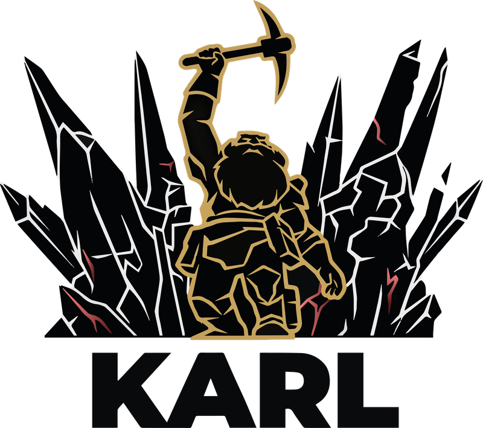
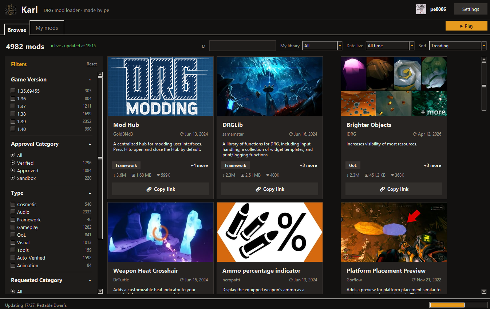

<p align="center">
  
</p>

**Karl** is a mod manager for **Deep Rock Galactic**, written in Python. Karl installs the mods itself, with no mod.io subscriptions and without going through the game's mod system. In the Browse tab you search DRG mods with the same filters as the website and copy their link; in the My mods tab you paste the links and Karl installs them.

## Download

Get the latest version from the **Releases** page. No Python needed.

- **Windows:** download `Karl.exe` and run it. It is a single file: put it wherever you like. On first launch Windows SmartScreen may say "Windows protected your PC" because the executable is not signed: click **More info → Run anyway**.
- **Linux:** download `karl-linux-x86_64.tar.gz`, extract it and run `./install.sh` from the `karl` folder. Karl then shows up in your applications menu. You can also run `./karl` directly.

## Install from source

Karl runs on **Windows** and on **Linux**, where DRG runs through Proton.

**Windows**

```bash
pip install -r requirements.txt
python main.py
```

Or build `Karl.exe` with `build_exe.bat` (see Building below).

**Linux**

Karl needs Tkinter, which many distributions ship as a separate package:

| Distribution | Command |
| --- | --- |
| Ubuntu, Debian, Pop!\_OS | `sudo apt install python3-tk python3-pil python3-pil.imagetk python3-venv` |
| Fedora | `sudo dnf install python3-tkinter python3-pillow-tk` |
| Arch, Manjaro, SteamOS | `sudo pacman -S tk python-pillow` |

Then run `python3 main.py`, or build the executable with `bash build_linux.sh`: it creates `dist/karl` and adds **Karl** to your applications menu.

Pillow is used for mod covers, which are often JPEG. Without it Karl still works but only shows PNG covers. `pip install -r requirements.txt` also installs **tkinterdnd2** (drag and drop) and **pystray** (icon in the notification area): both are optional, and without them Karl simply hides those features. The executables in the releases include them.

### Linux and Proton

Karl finds the game on its own, also with Steam installed from Flatpak or Snap and in libraries on other drives or the SD card. Everything else works as on Windows. On top of that:

- **Blueprint mods.** Under Proton, UE4SS only starts if Wine uses the `dwmapi.dll` in the game folder. Karl sets this up by itself in DRG's Proton prefix (`steamapps/compatdata/548430/pfx/user.reg`, the same thing `winecfg` would do), so you **don't** need to add `WINEDLLOVERRIDES` to the Steam launch options. The prefix only exists after the first launch: if you have never started DRG, Karl tells you. Start it once from Steam, close it and press **Install and save**. A copy of the original file is kept as `user.reg.karl-backup`.
- **UE4SS hooks.** Under Proton, some of UE4SS 3.0.1's engine hooks make DRG crash on the loading screen (`EXCEPTION_ACCESS_VIOLATION`, with a `crash_*.dmp` in `Binaries/Win64`). On Linux Karl turns all of them off in `UE4SS-settings.ini` (the `Hook… = 0` lines) together with UE4SS's crash dumper, and checks it again every time it saves. Karl's loader starts blueprint mods through a native hook, so Mod Hub and the other blueprint mods keep working. **Diagnostics** shows the state on the *Proton: UE4SS hooks* line.
- **Play** starts DRG through Steam (native or Flatpak). Karl detects the running game under Proton too, so developer mode can close and restart it as on Windows.

## Signing in with mod.io

Click **Sign in with mod.io** at the top right:

1. Your mod.io account's *Access* page opens.
2. Create a **personal access token** named "Karl": under Permissions tick only **User actions**, under Scope **Read** and **Write**, under Expiry the longest duration.
3. Paste it into Karl. It is checked right away and your name and avatar appear at the top.

In **Settings → mod.io token** you see which account you are connected to and the masked token (with **Show** and **Copy**), plus the expiry date read from the token, with a warning when fewer than 7 days are left. There are also **Verify**, **Change token…**, **Remove** and **Manage on mod.io** buttons. The token stays on your PC only. You can revoke it any time on mod.io or with **Sign out**.

<p align="center"></p>

Why no email login? mod.io only allows it for apps using the game's official API key (the DRG developers' one). Third-party apps sign in with a token created by the user.

### If you get error 401

A 401 means mod.io rejects the token. Karl also shows mod.io's exact code, for example `(401 · 11005)` for an expired or revoked token. What to do:

1. **Verify** in Settings → mod.io token checks both the account and reading DRG mods, and tells you which one fails.
2. If the account works but reading mods doesn't, create a new token ticking both **User actions** and **All my mods** under Permissions, with Read and Write.
3. Make sure you copied the whole token: mod.io shows it only once.

## Browse



The list of DRG mods from the website, with:

- **search** by name;
- **filters** in the left column: Game Version, Approval Category, Type and the other tag groups. Groups and counts come from mod.io, so they follow the website;
- **My library**: all, installed by Karl, not installed;
- **Date live**: all time, last 24 hours, week, month, year;
- **Sort**: trending, recently added, last updated, most popular, most subscribers, highest rated, alphabetical.

Each card shows cover, name, author, last update, description, type, downloads, size and subscribers. Clicking the title or the cover opens the mod's **details** (see below). The only button is **🔗 Copy link**: it copies the link to the clipboard and puts it in the *Mod links* box of the My mods tab, without installing anything. So you collect mods while browsing and then install them all at once with **Add**. Scrolling to the bottom loads more mods.

**Live updates.** mod.io does not send push notifications to third-party apps, so Karl checks again by itself every 60 seconds (configurable in Settings). It refreshes the visible mods and their stats. Your mod.io account's subscriptions don't matter: the mod list is Karl's own.

### How tag filters work

As on the website, tags within the same group are OR (e.g. 1.39 *or* 1.40) and different groups are AND. mod.io accepts a single OR list per request. If you pick several tags in two different groups, Karl filters the second group on the downloaded page: the result is correct, but the total shown at the top may be a bit higher.

## My mods


Here are the mods installed by Karl. Next to each name there is a **switch**: one click turns the mod on or off (disabled mods turn grey). The switch in the header turns them all on, or all off if they are already all on. The space bar works too; double-clicking a name opens the mod's details.

Switches **don't change the game right away**. Above the list there are two buttons:

- **🔄 Check for updates**: looks on mod.io for new versions of the mods in the active folder, without downloading anything. Mods with an update show their version as `1.0 → 1.1`. Karl never checks on its own when you switch folder, press Play or save: only with this button, or at startup if you turn it on in Settings.
- **💾 Install and save**: saves the switches, downloads the updates and puts only the enabled mods in the game (removing the disabled ones). The number in brackets is how many changes are still unsaved. If you close Karl with unsaved changes, it asks first.

The counters under the list show how many mods are installed, pending and waiting for an update.

**Mod folders.** You can keep several mod lists, for example "Normal", "HUD only", "With friends", and pick one from the **Folder** drop-down at the top. The game gets **only the mods of the active folder**: when you switch folder Karl applies it right away (like an Install and save), removing the other folders' mods from the game. Next to the drop-down there are **New** (empty folder), **Duplicate** (copy of the active one), **Rename** and **Delete**.

- Downloaded mods are shared: the same mod in three folders takes space only once.
- Mods you add go into the active folder; switches apply only there.
- **Remove** takes the mod out of the active folder; it is deleted for good (cache included) only if no other folder has it. The same goes when deleting a folder.
- The first time, all the mods you had end up in the "Default" folder.

**Load order.** The **#** column shows each mod's position: 1 is loaded first and has the highest priority. To move a mod, double-click its number (or right-click → **Load position…**) and type the new position: it works even while searching, so with many mods you can find a mod by name and send it straight where you want. You can also drag a mod up or down the list (or select it and use Alt+Up / Alt+Down). When two mods change the same game file, the **higher one wins**. Karl writes the position into the pak name (`FSD-WindowsNoEditor_karl_<name>_<priority>_P.pak`): Unreal gives `_<N>_P.pak` paks priority 100·(N+1), so a higher number wins. Each folder has its own order; the game uses it after **Install and save** (or **Play**). New mods go to the bottom.

**Conflicts.** Karl reads the file list inside each enabled mod's .pak and marks with ⇄ the mods that change the same game files as another enabled mod. Select one to see, in the status bar, which mods it clashes with, how many files they share and which one wins with the current load order (the higher one). Move a mod up or down to change the winner.

**Sharing a folder.** **Export** copies a code (`KARL1:...`) to the clipboard with the folder's mods and their switches. A friend pastes it into Karl with **Import**: Karl creates a new folder, downloads the mods they are missing and makes it active. Mods added from a .pak file are not included, since they exist only on your PC.

**Play.** The **▶ Play** button applies pending changes (like Install and save) and starts DRG through Steam. If the game is already running it does nothing.

**Play without mods.** The button next to Play takes all of Karl's mods out of the game (they stay in your folders, nothing is deleted), starts DRG and waits: when you close the game, Karl puts the mods back by itself. If you close Karl meanwhile, the mods are put back the next time you open it.

**Previous version.** When a mod updates, Karl keeps the previous version in its cache. If an update breaks something, select the mod and press **Previous version**: it goes back and stays locked (🔒 next to the version), so Install and save won't update it again. Pressing the same button again brings back the latest one. If Karl has no copy of the previous version (for example for a mod you just added), it downloads the file before the current one from mod.io.

**Time machine.** Every time you press **Install and save** (also through Play or when switching folder) Karl takes a snapshot of the active folder: which mods it had, in what order, on or off and at which version. If nothing changed, no new snapshot is made. **🕘 Time machine** lists them by date, with a summary of what changed each time (mods added or removed, versions, switches, order). Pick a moment and press **Restore**: the folder goes back exactly as it was, even with mods you had removed meanwhile. Mods brought back to a different version stay locked (🔒) until you press **Previous version** to return to the latest one. Each version's .pak files are stored only once (`~/.cache/karl/istantanee/`) and Karl keeps the last 50 snapshots of each folder (a folder you use a lot doesn't erase the others' history; if you rename a folder, its history follows it).

**History.** The second tab of the time machine, **History**, is a readable log of everything that happened, with date and time: mods added, removed, updated (old → new version), turned on or off, brought back to a previous version, load order changes, folder switches, crashes, games that went well and the results of the problem mod search. Filter it by folder or search it; Karl keeps the last 2000 entries, separately for each game installation (`cronologia.json`).

**What's new.** When **Install and save**, **Play** or a folder switch updates some mods, a window lists them with old → new version and their changelog from mod.io. After Karl updates itself, the same window shows the release notes. Tick *Don't show this again* to turn it off, or switch it back on in **Settings → Maintenance**.

**Favorites and notes.** Click the ☆ at the right end of a row to add the mod to your favorites (★), click again to remove it. The **Show** drop-down above the list switches between all mods and favorites only (to change the load order, show all mods). Select a mod and press **Note…** to write a short note (for example "only with friends" or "breaks the HUD with X"): mods with a note show ✎ next to their name, and selecting one shows the note in the status bar.

**Search, sorting and sizes.** The ⌕ box above the list filters the active folder as you type, by name, note or tag (Esc clears it). **Sort** orders the list by load order (the default), name, size, date added or last update, and the **Size** column shows how much space each mod takes. While the list is filtered or sorted by something other than load order, mods can't be dragged, but you can still set their position from the **#** column.

**Tags.** Select one or more mods and press **Tags…** (or right-click → **Tags…**) to give them your own labels, for example *HUD*, *Audio* or *To try*: tick the tags you already use or type a new one and press **Add**, so a typo never creates a duplicate tag. The ✕ next to a tag deletes it from every mod that uses it. Tags have their own **Tags** column, the **Show** drop-down gets a *Tag: …* entry for each one plus **Without tags** (handy to make sure every mod has one), and the search finds them too. Tags travel with **Export configuration**.

**Right-click menu.** Right-click a mod (or a selection) for quick access to everything: turn on or off, favorite, load position, start in other players' lobbies, details, open on mod.io, previous version, note, tags and remove.

**Drag and drop.** Drop `.pak` or `.zip` files, or mod.io links dragged from the browser, anywhere on Karl's window: they go into the *Mod links* box and Karl adds them right away.

**Removed mods.** With **Warn me when a mod I use is removed from mod.io** ticked in Settings (on by default), Karl checks at startup whether any of your mods was deleted or hidden on mod.io. It tells you which ones and marks them with ⊘: Karl keeps the copy you have, but those mods won't get updates anymore.

**Mod details.** Double-click a mod in My mods, or click a card in Browse: a window shows cover, author, stats, the game versions the mod is marked for, the full description, its images (click one to open it full size), the last versions with their changelog, and the mods it requires. Buttons open the mod.io page or copy the link, and **▲ / ▼** send your vote to mod.io with your account (click the same arrow again to remove it).

**Required mods.** Karl reads from mod.io which other mods each mod needs (for example Mod Hub or DRGLib). If one is missing from the active folder or turned off, the mod shows ⚠ next to its name, selecting it tells you what is missing, and after **Add** Karl lists the missing ones with their links. It never installs anything on its own: you add them like any other mod.

**After a DRG update.** At startup Karl reads the game's build number from Steam. When it changes, it tells you which mods turned on in the active folder are not yet marked on mod.io for the latest game version, so you know which ones might break.

**Safe downloads.** Every file downloaded from mod.io is checked against the MD5 that mod.io publishes: a damaged or incomplete download is thrown away and never installed.

**One window only.** If you open Karl while it's already running, the open window comes to the front instead of starting a second copy.

**Moving to another PC.** In **Settings → Export configuration…** Karl saves one `.karl` file with all your folders, load order, switches, locked versions, favorites and notes. On the other PC (Windows or Linux) use **Import configuration…**: Karl downloads the missing mods, restores locked mods at their exact version and applies the active folder. Folders with the same name are replaced; mods added from .pak files are not included, since they only exist on your PC.

**Disk space.** **Settings → Disk space…** shows how much space mods in use, time machine snapshots, files no longer used, downloaded covers and previous versions take, and frees what you select. Deleting previous versions means **Previous version** won't work until the mods update again.

**Automatic checks.** In **Settings → Maintenance** you can have Karl check for updates of all your mods, in every folder, at every startup, and have Karl check for new versions of itself (see below).

**Diagnostics and log.** **Settings → Diagnostics…** checks the game folder, write permissions, the mods (missing files, load order, required mods, conflicts, removed mods), other mod loaders, blueprint mod support, Proton and the mod.io connection, and lists the warnings and errors in the log since Karl was opened. **Copy** or **Save…** the report and attach it to an issue (the token is hidden). **Open log** opens `karl.log` directly.

**Notification area.** With **Show Karl in the notification area** ticked (on by default), Karl's icon sits next to the clock: double-click it to bring Karl to the front, or right-click for **Play**, **Play without mods**, the folder list and **Quit Karl**. Tick **Closing the window keeps Karl in the notification area** to hide the window instead of quitting when you close it. On Linux the icon needs a desktop with a system tray (KDE, Cinnamon, XFCE; GNOME needs the AppIndicator extension).

**Updating Karl.** At the bottom right, next to the progress bar, there is a **GitHub ↗** link to this page. If **Show the Karl update icon** is ticked in **Settings → Maintenance**, the ⟳ update icon appears next to it. With **Check for new versions of Karl at every startup** also ticked, Karl checks GitHub each time it opens; untick it and Karl checks only when you click the icon. When a new version is out the icon becomes **⟳ !**. Click it and Karl updates itself: it downloads the new `Karl.exe` (or the Linux binary) from the latest release, replaces the old one and restarts. With no update pending, clicking ⟳ checks again right away. If you run Karl from the source code, the icon opens the releases page instead (update with `git pull`). Untick **Show the Karl update icon** to hide the icon and stop every check.

**Several game installations.** In **Settings → Game installation** press **Add…**, give it a name (for example *SD card* or *Second copy*) and pick its Paks folder with **Browse** or **Detect**. Choose an installation in the list and press **Save** to switch to it. Each installation has its own mod folders, load order, switches, time machine and downloaded files, so different versions of the same mod never get mixed up. With more than one installation, the active one is shown next to Karl's name at the top. **Remove** deletes Karl's data for an installation (not the mods already in that game folder); the active and the main installation can't be removed. Note that Steam's beta branches replace the game files in the same folder: a separate installation is useful when DRG really is in two places, for example on two drives or a copy of the game.

**Interface size.** **Settings → Interface size** makes text, buttons, list rows and cards bigger: 100%, 125%, 150%, 175% or 200%. Handy on 4K screens. Karl applies it after a restart and offers to restart right away. **Compact mod list**, right below, makes only the rows of *My mods* shorter, so more mods fit on the screen.

**Compact mode.** **Hide links** (above the list, or Ctrl+L) hides the *Mod links* box to give the list more room, handy on small screens. Karl remembers the choice; the box comes back by itself when you copy a link from Browse.

**Keyboard shortcuts.**

| Key | Action |
| --- | --- |
| Ctrl+F | Search (in Browse or My mods, depending on the open tab) |
| F5 | Check for updates in My mods, reload the list in Browse |
| Ctrl+S | Install and save |
| Ctrl+L | Hide or show the Mod links box |
| Delete | Remove the selected mods |
| Space | Turn the selected mods on or off |
| Ctrl+A | Select all the mods in the list |
| Alt+Up / Alt+Down | Move the selected mod in the load order |
| Ctrl+Enter | Add the links in the box |
| Esc | Clear the search |

**Developer mode** (for modders). With the box ticked, every 2 seconds Karl checks the date of the .pak files of mods you added from a file: when you rebuild one, it reimports it and puts it back in the game by itself. While DRG is running the pak is in use: Karl waits until you close the game or, if you also ticked **Restart DRG when a mod changes**, closes DRG, updates the mod and starts it again.

**Crash detection** (in the *Mod development* section, on by default). After you start DRG from Karl, Karl waits for the game to close and checks whether it crashed: the critical error in `FSD/Saved/Logs/FSD.log`, the game's crash reports and the `crash_*.dmp` files UE4SS writes in `Binaries/Win64`. If it did, a window shows the error and what changed since the last game that went well, with buttons to **Find the culprit mod** or open the time machine. If you close Karl while playing, it checks the next time it starts.

**Find problem mod…** (same section). A guided search for the mod that breaks the game: Karl turns half of the mods that are on off, you press **Start DRG**, try what was going wrong, close the game and answer *The problem is still there* or *Now it works*. Karl halves again until one mod is left (about 5 tests with 30 mods). Required mods such as Mod Hub or DRGLib stay on together with the mods that use them, so they never break things for the wrong reason, and if Karl detects a crash during a test it tells you. At the end you can turn the culprit off and keep everything else, or put everything back. If you cancel, or Karl is closed halfway, your mods go back exactly as they were.

**Adding many mods at once.** In the *Mod links* box paste as many links as you like (`https://mod.io/g/drg/m/mod-name`), one per line or separated by spaces or commas, then press **Add** or Ctrl+Enter. Karl:

- pastes mod.io links from the clipboard by itself when you click in the box;
- tells you how many mods it found and ignores lines that aren't mod.io links;
- skips duplicates;
- adds the mods one at a time, filling the list as it goes;
- if a mod can't be added it moves on, then tells you which ones failed and puts their links back in the box to retry.

### How Karl installs mods

Karl installs the mods: you don't have to do anything in the game. Karl downloads each mod and puts its pak in the game's pak folder, next to `FSD-WindowsNoEditor.pak`:

```
...\Deep Rock Galactic\FSD\Content\Paks\FSD-WindowsNoEditor_karl_<name>_P.pak
```

On Linux it is the same folder, inside `steamapps/common/` of your Steam library. The game loads these paks by itself at startup. The name is not random: the game's mod registry (the SimpleUGC module) treats every pak in `Content\Paks` whose name does **not** contain `FSD-WindowsNoEditor` as a "manually installed mod" (it is the check at address `0x14131e943` of `FSD-Win64-Shipping.exe`). With this name the registry ignores them and the game behaves as unmodded. So:

- the game's mod menu shows **0 mods** installed;
- **no "MOD" tag** appears next to the player name;
- Karl **never subscribes you** to mods on mod.io.

The game counts mods as "its own" in two places: your **mod.io account subscriptions** (it downloads them again itself) and the **folders in `FSD\Mods`**. To keep it at 0 mods, at startup and at every **Install and save** Karl checks both and offers to empty them: it cancels the subscriptions and moves the folders to `FSD\_karl_backup_mods` (deleting nothing). All those mods stay in Karl and Karl installs them. If you build your own mod, output it to another folder and add it with **Add .pak file…**: when you rebuild it, **Install and save** reimports it.

**Non-Verified mods.** The Category column shows Verified, Approved or Sandbox. Keep in mind that with Karl the game doesn't flag Approved and Sandbox mods to the other players in the lobby, and Sandbox mods write to your normal save instead of the sandbox one.

### Blueprint mods: Karl's integration

Many mods (Mod Hub, HUDs, libraries like DRGLib) have two startup blueprints, `/Game/<Mod>/InitSpacerig` and `/Game/<Mod>/InitCave`, which the game's mod system normally spawns. Since Karl skips that system, it starts them itself:

- it installs **UE4SS** (open source framework, github.com/UE4SS-RE/RE-UE4SS, MIT license) in `FSD\Binaries\Win64`: it loads with the game through `dwmapi.dll` and runs Lua scripts;
- it adds its own Lua mod **KarlLoader** (`karl/loader/main.lua`): when you enter the Space Rig it spawns the active mods' `InitSpacerig`, when a mission starts their `InitCave`. It waits a moment after the map has loaded and tries again a few times for a blueprint that isn't ready yet;
- at every **Install and save** and before every **Play** it rewrites the list (`KarlLoader/Scripts/karl_mods.lua`), reading inside each pak which startup blueprints it contains (`karl/pakfile.py`). Required mods (libraries like Mod Hub and DRGLib) are started before the mods that need them. In someone else's lobby only *Verified* mods and your own `.pak` files are started: *Approved* and *Sandbox* mods change the gameplay and only run when you are the host, as with the game's own mod system.

Karl offers to install it by itself when blueprint mods are enabled. If it finds the files of another mod loader (for example a hook `x3daudio1_7.dll` or its own UE4SS variant) it moves them to `FSD\_karl_backup_altri_loader`, without deleting them. If something doesn't start, the log is in `FSD\Binaries\Win64\ue4ss\UE4SS.log` (lines starting with `[Karl]`), and **Diagnostics** shows which blueprints didn't start the last time you played.

Two things to keep in mind:

- install and update mods **with the game closed**: Windows doesn't allow replacing files the game is using, and on Linux the running game would keep using the old version. Karl stops **Install and save** while DRG is open;
- don't enable in the game's mod menu the same mods Karl installs, or they would be loaded twice.

### Multiplayer and the game's mod system

Karl installs mods outside DRG's built-in mod menu, so **the game doesn't know which mods you are using**. This has some consequences worth knowing:

- when you **host**, your lobby is **not marked as modded** in the server browser, even with *Approved* or *Sandbox* mods enabled;
- *Sandbox* mods **don't turn off progression** as they do when you enable them from the game's menu;
- when you **join someone else's lobby**, Karl only starts *Verified* mods (client-side, allowed everywhere) and your own `.pak` files. *Approved* and *Sandbox* mods stay off until you host again, so you never bring gameplay changes into another player's game.

Some *Approved* mods only affect your own screen (HUDs, menus, indicators) and are safe in any lobby. For those, right-click the mod and choose **Start in other players' lobbies**: the *Category* column shows *Approved · online* and Karl starts it when you join someone else's game too. Choose **Don't start in other players' lobbies** to go back. Turn it on only for mods that don't change gameplay (enemies, damage, missions, equipment), or your game will go out of sync with the host's: no weapons, enemies dealing no damage, objects that don't break. Note that the files a mod replaces inside the game (models, values, sounds) are loaded when DRG starts, so they stay active in every lobby: this switch only decides whether the mod's startup blueprints run.

**Adding your own .pak files.** For a mod that isn't on mod.io, for example one you are making, press **Add .pak file…** and pick one or more `.pak` or `.zip` files. You can also paste the file path into the box, even in quotes as Windows' "Copy as path" does. Karl copies the pak into the game folder as `Content\Paks\FSD-WindowsNoEditor_karl_file-<name>_P.pak` and shows it as *.pak file* in the Category column. When you rebuild the mod, add the same file again: Karl updates the existing mod instead of creating a new one.

**Install and save** fixes the whole library, one mod at a time:

- downloads the updates found by **Check for updates** (or by the startup check);
- reimports mods added from a .pak/.zip file if the original file changed;
- reinstalls into the game folder the enabled mods whose pak disappeared (for example after Steam's "verify game files") and removes those of disabled mods.

If a mod fails, Karl moves on to the others and lists the failed ones at the end.

Karl only touches folders and files starting with `karl_`: the game's original files are never changed or deleted.

## Command line

```bash
python main.py config --token XXXX --paks "/path/to/Paks"
python main.py add https://mod.io/g/drg/m/mod-name
python main.py list
python main.py disable 123456
python main.py update
```

## Language

In **Settings → Language** you can pick one of the same 17 languages as Deep Rock Galactic: English, Italian, French, German, Spanish (Spain), Polish, Portuguese (Brazil), Russian, Simplified Chinese, Traditional Chinese, Ukrainian, Japanese, Korean, Turkish, Spanish (Latin America), Hungarian and Romanian. There is also **Automatic**, which follows the system language. The change is immediate, no restart needed.

mod.io filter names (groups and tags) are translated too, when the website provides a translation. The texts live in `karl/locales/<language>.json`; to check them: `python tests/check_locales.py`.

## Where Karl stores its data

- `~/.config/karl/config.json`: settings and token, with permissions 600
- `~/.config/karl/mods.json`: mod list
- `~/.config/karl/cartelle.json`: mod folders
- `~/.config/karl/istantanee.json`: time machine snapshots
- `~/.config/karl/cronologia.json`: history
- `~/.cache/karl/`: downloaded paks and covers
- `~/.config/karl/installs/<id>/` and `~/.cache/karl/installs/<id>/`: the same files for each extra game installation

## Project layout

```
main.py                  entry point (GUI or CLI)
karl/modio.py            mod.io API client (account, tags, search, ratings, downloads)
karl/paths.py            config and cache folders, per installation
karl/config.py           settings and Steam lookup
karl/entry.py            a mod in the library
karl/library.py          the library: adding, removing, installing into Content/Paks
karl/folders.py          folders, share codes and profiles
karl/updates.py          updates, previous versions, dependencies
karl/gamefiles.py        game folder: other loaders, UE4SS, Proton, conflicts, cache
karl/pakfile.py          .pak index reader (finds InitSpacerig/InitCave)
karl/timemachine.py      snapshots and restore (time machine)
karl/history.py          change history
karl/proton.py           Linux: dwmapi override in the Proton prefix
karl/game.py             starting, detecting and closing DRG (Windows and Linux)
karl/integration.py      UE4SS + KarlLoader (starting blueprint mods)
karl/loader/             KarlLoader Lua script
karl/crash.py            crash detection
karl/bisect.py           problem mod search
karl/selfupdate.py       Karl updates
karl/diagnostics.py      diagnostics report
karl/browse.py           Browse tab (filters, cards, auto refresh)
karl/details.py          mod details window
karl/tray.py             notification area icon
karl/gui/app.py          main window
karl/gui/mine.py         My mods tab
karl/gui/settings.py     settings
karl/gui/dialogs.py      sign-in, diagnostics, what's new, cache
karl/gui/timemachine.py  time machine and history window
karl/gui/troubleshoot.py crash report and problem mod search windows
karl/gui/common.py       shared GUI helpers
karl/ui.py               interface size
karl/widgets.py          shared widgets: buttons, checkboxes, text boxes
karl/single.py           single instance
karl/log.py              log file
karl/theme.py            colors and fonts
karl/i18n.py             translations (karl/locales/*.json), sizes and dates
karl/cli.py              command line
tests/                   offline tests: test_core.py, test_browse.py, test_integration.py
packaging/               install.sh for the Linux package
.github/workflows/       automatic release builds
```

## Building

**GitHub release.** The `.github/workflows/release.yml` workflow builds the executables by itself. Update `VERSION` in `karl/__init__.py`, then create and push a tag with the same number:

```bash
git tag v0.1.1
git push origin v0.1.1
```

GitHub runs the tests, builds `Karl.exe` on Windows and `karl-linux-x86_64.tar.gz` on Linux and attaches them to a new release. If the tag doesn't match `VERSION`, it stops before building.

**On your own PC:**

- **Windows:** double-click `build_exe.bat` (or run it from a terminal in the folder with `main.py`). It installs PyInstaller and creates `dist\Karl.exe`: a single file, with Karl's logo and no console window.
- **Linux:** `bash build_linux.sh` creates `dist/karl` and the applications menu entry.

Karl's data stays in `~/.config/karl`.

## Reporting issues

Found a bug or have an idea? Open an issue on the **Issues** page of the repository. To help track it down, include:

- your system (Windows or Linux, which distribution) and Karl's version;
- what you did, what you expected and what happened instead;
- the error message or a screenshot, if any;
- Karl's log file, `~/.cache/karl/karl.log` (on Windows `C:\Users\<you>\.cache\karl\karl.log`);
- for blueprint mods that don't start: the UE4SS log, `FSD\Binaries\Win64\ue4ss\UE4SS.log` (the lines starting with `[Karl]` are the most useful).

## Credits

- [UE4SS](https://github.com/UE4SS-RE/RE-UE4SS) (MIT license), which Karl downloads and installs to start blueprint mods.
- [mod.io](https://mod.io), whose public API powers the Browse tab and the downloads.
- [Pillow](https://python-pillow.org), for mod covers.
- [tkinterdnd2](https://github.com/Eliav2/tkinterdnd2), for drag and drop.
- [pystray](https://github.com/moses-palmer/pystray), for the icon in the notification area.
- All the DRG modders whose mods Karl installs: Karl only downloads them, they remain their authors' work.

## Disclaimer

Karl is an unofficial fan project. It is not affiliated with, endorsed or sponsored by Ghost Ship Games, Coffee Stain or mod.io. Deep Rock Galactic and its assets are trademarks of their respective owners.

## Logo

The Karl logos were manually designed by Zoppone.

## Testing

Thanks to Cybo for testing Karl and helping find bugs.
