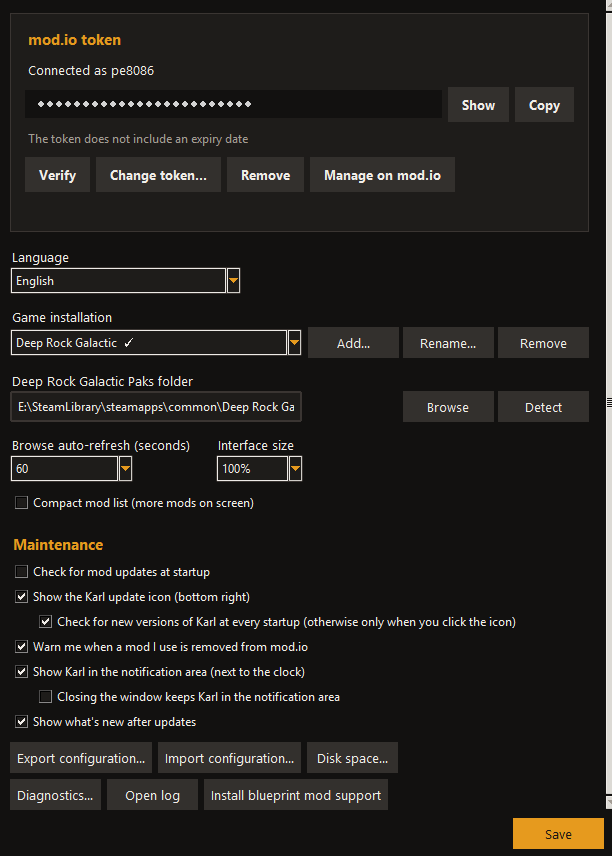
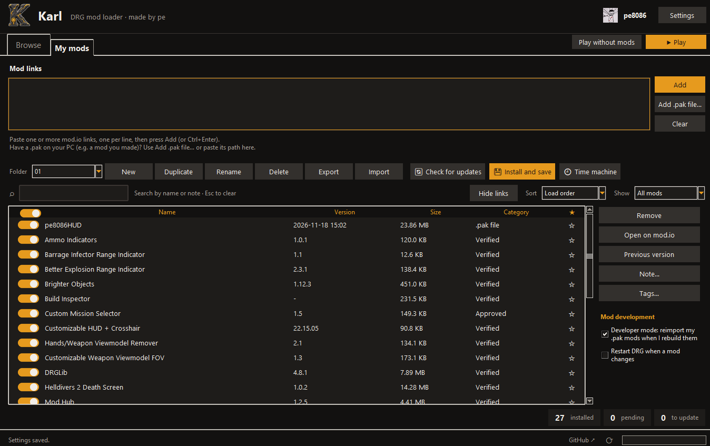

<p align="center">
  
</p>

**Karl** is a mod manager for **Deep Rock Galactic**, written from scratch in Python. Karl installs the mods itself, with no mod.io subscriptions and without going through the game's mod system. In the Browse tab you search DRG mods with the same filters as the website and copy their link; in the My mods tab you paste the links and Karl installs them.

## Download

Get the latest version from the **Releases** page. No Python needed.

- **Windows:** download `Karl.exe` and run it. It is a single file: put it wherever you like. On first launch Windows SmartScreen may say "Windows protected your PC" because the executable is not signed: click **More info → Run anyway**.
- **Linux / Steam Deck:** download `karl-linux-x86_64.tar.gz`, extract it and run `./install.sh` from the `karl` folder. Karl then shows up in your applications menu. You can also run `./karl` directly.

## Install from source

Karl runs on **Windows** and on **Linux** (Steam Deck included), where DRG runs through Proton.

**Windows**

```bash
pip install -r requirements.txt
python main.py
```

Or build `Karl.exe` with `build_exe.bat` (see Building below).

**Linux**

Karl needs Tkinter, which many distributions ship as a separate package:

| Distribution | Command |
| --- | --- |
| Ubuntu, Debian, Pop!\_OS | `sudo apt install python3-tk python3-pil python3-pil.imagetk python3-venv` |
| Fedora | `sudo dnf install python3-tkinter python3-pillow-tk` |
| Arch, Manjaro, SteamOS | `sudo pacman -S tk python-pillow` |

Then run `python3 main.py`, or build the executable with `bash build_linux.sh`: it creates `dist/karl` and adds **Karl** to your applications menu.

Pillow is used for mod covers, which are often JPEG. Without it Karl still works but only shows PNG covers.

### Linux and Proton

Karl finds the game on its own, also with Steam installed from Flatpak or Snap and in libraries on other drives or the SD card. Everything else works as on Windows. On top of that:

- **Blueprint mods.** Under Proton, UE4SS only starts if Wine uses the `dwmapi.dll` in the game folder. Karl sets this up by itself in DRG's Proton prefix (`steamapps/compatdata/548430/pfx/user.reg`, the same thing `winecfg` would do), so you **don't** need to add `WINEDLLOVERRIDES` to the Steam launch options. The prefix only exists after the first launch: if you have never started DRG, Karl tells you. Start it once from Steam, close it and press **Install and save**. A copy of the original file is kept as `user.reg.karl-backup`.
- **Play** starts DRG through Steam (native or Flatpak). Karl detects the running game under Proton too, so developer mode can close and restart it as on Windows.

## Signing in with mod.io

Click **Sign in with mod.io** at the top right:

1. Your mod.io account's *Access* page opens.
2. Create a **personal access token** named "Karl": under Permissions tick only **User actions**, under Scope **Read** and **Write**, under Expiry the longest duration.
3. Paste it into Karl. It is checked right away and your name and avatar appear at the top.

In **Settings → mod.io token** you see which account you are connected to and the masked token (with **Show** and **Copy**), plus the expiry date read from the token, with a warning when fewer than 7 days are left. There are also **Verify**, **Change token…**, **Remove** and **Manage on mod.io** buttons. The token stays on your PC only. You can revoke it any time on mod.io or with **Sign out**.

<p align="center"></p>

Why no email login? mod.io only allows it for apps using the game's official API key (the DRG developers' one). Third-party apps sign in with a token created by the user.

### If you get error 401

A 401 means mod.io rejects the token. Karl also shows mod.io's exact code, for example `(401 · 11005)` for an expired or revoked token. What to do:

1. **Verify** in Settings → mod.io token checks both the account and reading DRG mods, and tells you which one fails.
2. If the account works but reading mods doesn't, create a new token ticking both **User actions** and **All my mods** under Permissions, with Read and Write.
3. Make sure you copied the whole token: mod.io shows it only once.

## Browse


The list of DRG mods from the website, with:

- **search** by name;
- **filters** in the left column: Game Version, Approval Category, Type and the other tag groups. Groups and counts come from mod.io, so they follow the website;
- **My library**: all, installed by Karl, not installed;
- **Date live**: all time, last 24 hours, week, month, year;
- **Sort**: trending, recently added, last updated, most popular, most subscribers, highest rated, alphabetical.

Each card shows cover, name, author, last update, description, type, downloads, size and subscribers. Clicking the title or the cover opens the mod's page on the website. The only button is **🔗 Copy link**: it copies the link to the clipboard and puts it in the *Mod links* box of the My mods tab, without installing anything. So you collect mods while browsing and then install them all at once with **Add**. Scrolling to the bottom loads more mods.

**Live updates.** mod.io does not send push notifications to third-party apps, so Karl checks again by itself every 60 seconds (configurable in Settings). It refreshes the visible mods and their stats. Your mod.io account's subscriptions don't matter: the mod list is Karl's own.

### How tag filters work

As on the website, tags within the same group are OR (e.g. 1.39 *or* 1.40) and different groups are AND. mod.io accepts a single OR list per request. If you pick several tags in two different groups, Karl filters the second group on the downloaded page: the result is correct, but the total shown at the top may be a bit higher.

## My mods



Here are the mods installed by Karl. Next to each name there is a **switch**: one click turns the mod on or off (disabled mods turn grey). The switch in the header turns them all on, or all off if they are already all on. The space bar and double-clicking the name work too.

Switches **don't change the game right away**. Above the list there are two buttons:

- **🔄 Check for updates**: looks on mod.io for new versions of the mods in the active folder, without downloading anything. Mods with an update show their version as `1.0 → 1.1`. Karl never checks on its own when you switch folder, press Play or save: only with this button, or at startup if you turn it on in Settings.
- **💾 Install and save**: saves the switches, downloads the updates and puts only the enabled mods in the game (removing the disabled ones). The number in brackets is how many changes are still unsaved. If you close Karl with unsaved changes, it asks first.

The counters under the list show how many mods are installed, pending and waiting for an update.

**Mod folders.** You can keep several mod lists, for example "Normal", "HUD only", "With friends", and pick one from the **Folder** drop-down at the top. The game gets **only the mods of the active folder**: when you switch folder Karl applies it right away (like an Install and save), removing the other folders' mods from the game. Next to the drop-down there are **New** (empty folder), **Duplicate** (copy of the active one), **Rename** and **Delete**.

- Downloaded mods are shared: the same mod in three folders takes space only once.
- Mods you add go into the active folder; switches apply only there.
- **Remove** takes the mod out of the active folder; it is deleted for good (cache included) only if no other folder has it. The same goes when deleting a folder.
- The first time, all the mods you had end up in the "Default" folder.

**Load order.** Drag a mod up or down the list (or select it and use Alt+Up / Alt+Down). When two mods change the same game file, the **higher one wins**. Karl writes the position into the pak name (`FSD-WindowsNoEditor_karl_<name>_<priority>_P.pak`): Unreal gives `_<N>_P.pak` paks priority 100·(N+1), so a higher number wins. Each folder has its own order; the game uses it after **Install and save** (or **Play**). New mods go to the bottom.

**Sharing a folder.** **Export** copies a code (`KARL1:...`) to the clipboard with the folder's mods and their switches. A friend pastes it into Karl with **Import**: Karl creates a new folder, downloads the mods they are missing and makes it active. Mods added from a .pak file are not included, since they exist only on your PC.

**Play.** The **▶ Play** button applies pending changes (like Install and save) and starts DRG through Steam. If the game is already running it does nothing.

**Previous version.** When a mod updates, Karl keeps the previous version in its cache. If an update breaks something, select the mod and press **Previous version**: it goes back and stays locked (🔒 next to the version), so Install and save won't update it again. Pressing the same button again brings back the latest one.

**Time machine.** Every time you press **Install and save** (also through Play or when switching folder) Karl takes a snapshot of the active folder: which mods it had, in what order, on or off and at which version. If nothing changed, no new snapshot is made. **🕘 Time machine** lists them by date, with a summary of what changed each time (mods added or removed, versions, switches, order). Pick a moment and press **Restore**: the folder goes back exactly as it was, even with mods you had removed meanwhile. Mods brought back to a different version stay locked (🔒) until you press **Previous version** to return to the latest one. Each version's .pak files are stored only once (`~/.cache/karl/istantanee/`) and Karl keeps the last 50 snapshots of each folder (a folder you use a lot doesn't erase the others' history; if you rename a folder, its history follows it).

**Favorites and notes.** Click the ☆ at the right end of a row to add the mod to your favorites (★), click again to remove it. The **Show** drop-down above the list switches between all mods and favorites only (to change the load order, show all mods). Select a mod and press **Note…** to write a short note (for example "only with friends" or "breaks the HUD with X"): mods with a note show ✎ next to their name, and selecting one shows the note in the status bar.

**Moving to another PC.** In **Settings → Export configuration…** Karl saves one `.karl` file with all your folders, load order, switches, locked versions, favorites and notes. On the other PC (Windows or Linux) use **Import configuration…**: Karl downloads the missing mods, restores locked mods at their exact version and applies the active folder. Folders with the same name are replaced; mods added from .pak files are not included, since they only exist on your PC.

**Disk space.** **Settings → Disk space…** shows how much space mods in use, time machine snapshots, files no longer used, downloaded covers and previous versions take, and frees what you select. Deleting previous versions means **Previous version** won't work until the mods update again.

**Automatic checks.** In **Settings → Maintenance** you can have Karl check for updates of all your mods, in every folder, at every startup, and get a notice when a new version of Karl is released on GitHub (you can skip a version you don't want).

**Developer mode** (for modders). With the box ticked, every 2 seconds Karl checks the date of the .pak files of mods you added from a file: when you rebuild one, it reimports it and puts it back in the game by itself. While DRG is running the pak is in use: Karl waits until you close the game or, if you also ticked **Restart DRG when a mod changes**, closes DRG, updates the mod and starts it again.

**Adding many mods at once.** In the *Mod links* box paste as many links as you like (`https://mod.io/g/drg/m/mod-name`), one per line or separated by spaces or commas, then press **Add** or Ctrl+Enter. Karl:

- pastes mod.io links from the clipboard by itself when you click in the box;
- tells you how many mods it found and ignores lines that aren't mod.io links;
- skips duplicates;
- adds the mods one at a time, filling the list as it goes;
- if a mod can't be added it moves on, then tells you which ones failed and puts their links back in the box to retry.

### How Karl installs mods

Karl installs the mods: you don't have to do anything in the game. Karl downloads each mod and puts its pak in the game's pak folder, next to `FSD-WindowsNoEditor.pak`:

```
...\Deep Rock Galactic\FSD\Content\Paks\FSD-WindowsNoEditor_karl_<name>_P.pak
```

On Linux it is the same folder, inside `steamapps/common/` of your Steam library. The game loads these paks by itself at startup. The name is not random: the game's mod registry (the SimpleUGC module) treats every pak in `Content\Paks` whose name does **not** contain `FSD-WindowsNoEditor` as a "manually installed mod" (it is the check at address `0x14131e943` of `FSD-Win64-Shipping.exe`). With this name the registry ignores them and the game behaves as unmodded. So:

- the game's mod menu shows **0 mods** installed;
- **no "MOD" tag** appears next to the player name;
- Karl **never subscribes you** to mods on mod.io.

The game counts mods as "its own" in two places: your **mod.io account subscriptions** (it downloads them again itself) and the **folders in `FSD\Mods`**. To keep it at 0 mods, at startup and at every **Install and save** Karl checks both and offers to empty them: it cancels the subscriptions and moves the folders to `FSD\_karl_backup_mods` (deleting nothing). All those mods stay in Karl and Karl installs them. If you build your own mod, output it to another folder and add it with **Add .pak file…**: when you rebuild it, **Install and save** reimports it.

At startup Karl moves into `Content\Paks` the mods that older versions put in `FSD\Mods` and converts the ones that were in subscription mode.

**Non-Verified mods.** The Category column shows Verified, Approved or Sandbox. When you add an Approved or Sandbox mod, Karl warns you: the game doesn't flag it to the other players in the lobby, and Sandbox mods write to your normal save instead of the sandbox one.

### Blueprint mods: Karl's integration

Many mods (Mod Hub, HUDs, libraries like DRGLib) have two startup blueprints, `/Game/<Mod>/InitSpacerig` and `/Game/<Mod>/InitCave`, which the game's mod system normally spawns. Since Karl skips that system, it starts them itself:

- it installs **UE4SS** (open source framework, github.com/UE4SS-RE/RE-UE4SS, MIT license) in `FSD\Binaries\Win64`: it loads with the game through `dwmapi.dll` and runs Lua scripts;
- it adds its own Lua mod **KarlLoader** (`karl/loader/main.lua`): when you enter the Space Rig it spawns the active mods' `InitSpacerig`, when a mission starts their `InitCave`;
- at every **Install and save** it rewrites the list (`KarlLoader/Scripts/karl_mods.lua`), reading inside each pak which startup blueprints it contains (`karl/pakfile.py`).

Karl offers to install it by itself when blueprint mods are enabled. If it finds the files of another mod loader (for example a hook `x3daudio1_7.dll` or its own UE4SS variant) it moves them to `FSD\_karl_backup_altri_loader`, without deleting them. If something doesn't start, the log is in `FSD\Binaries\Win64\ue4ss\UE4SS.log` (lines starting with `[Karl]`).

Two things to keep in mind:

- install and update mods **with the game closed**: Windows doesn't allow replacing files the game is using, and on Linux the running game would keep using the old version;
- don't enable in the game's mod menu the same mods Karl installs, or they would be loaded twice.

**Adding your own .pak files.** For a mod that isn't on mod.io, for example one you are making, press **Add .pak file…** and pick one or more `.pak` or `.zip` files. You can also paste the file path into the box, even in quotes as Windows' "Copy as path" does. Karl copies the pak into the game folder as `Content\Paks\FSD-WindowsNoEditor_karl_file-<name>_P.pak` and shows it as *.pak file* in the Category column. When you rebuild the mod, add the same file again: Karl updates the existing mod instead of creating a new one.

**Install and save** fixes the whole library, one mod at a time:

- downloads the updates found by **Check for updates** (or by the startup check);
- reimports mods added from a .pak/.zip file if the original file changed;
- reinstalls into the game folder the enabled mods whose pak disappeared (for example after Steam's "verify game files") and removes those of disabled mods.

If a mod fails, Karl moves on to the others and lists the failed ones at the end.

Karl only touches folders and files starting with `karl_`: the game's original files are never changed or deleted.

## Command line

```bash
python main.py config --token XXXX --paks "/path/to/Paks"
python main.py add https://mod.io/g/drg/m/mod-name
python main.py list
python main.py disable 123456
python main.py update
```

## Language

In **Settings → Language** you can pick one of the same 17 languages as Deep Rock Galactic: English, Italian, French, German, Spanish (Spain), Polish, Portuguese (Brazil), Russian, Simplified Chinese, Traditional Chinese, Ukrainian, Japanese, Korean, Turkish, Spanish (Latin America), Hungarian and Romanian. There is also **Automatic**, which follows the system language. The change is immediate, no restart needed.

mod.io filter names (groups and tags) are translated too, when the website provides a translation. The texts live in `karl/locales/<language>.json`; to check them: `python tests/check_locales.py`.

## Where Karl stores its data

- `~/.config/karl/config.json`: settings and token, with permissions 600
- `~/.config/karl/mods.json`: mod list
- `~/.config/karl/cartelle.json`: mod folders
- `~/.config/karl/istantanee.json`: time machine snapshots
- `~/.cache/karl/`: downloaded paks and covers

## Project layout

```
main.py             entry point (GUI or CLI)
karl/modio.py       mod.io API client (account, tags, search, subscriptions, downloads)
karl/library.py     config, Steam lookup, installing into Content/Paks
karl/pakfile.py     .pak index reader (finds InitSpacerig/InitCave)
karl/timemachine.py snapshots and restore (time machine)
karl/proton.py      Linux: dwmapi override in the Proton prefix
karl/game.py        starting, detecting and closing DRG (Windows and Linux)
karl/integration.py UE4SS + KarlLoader (starting blueprint mods)
karl/loader/        KarlLoader Lua script
karl/browse.py      Browse tab (filters, cards, auto refresh)
karl/gui.py         main window, sign-in, My mods, settings
karl/theme.py       colors and fonts
karl/i18n.py        translations (karl/locales/*.json)
karl/cli.py         command line
tests/              offline tests: test_core.py, test_browse.py, test_integration.py
packaging/          install.sh for the Linux package
.github/workflows/  automatic release builds
```

## Building

**GitHub release.** The `.github/workflows/release.yml` workflow builds the executables by itself. Update `VERSION` in `karl/__init__.py`, then create and push a tag with the same number:

```bash
git tag v0.1.1
git push origin v0.1.1
```

GitHub runs the tests, builds `Karl.exe` on Windows and `karl-linux-x86_64.tar.gz` on Linux and attaches them to a new release. If the tag doesn't match `VERSION`, it stops before building.

**On your own PC:**

- **Windows:** double-click `build_exe.bat` (or run it from a terminal in the folder with `main.py`). It installs PyInstaller and creates `dist\Karl.exe`: a single file, with Karl's logo and no console window.
- **Linux:** `bash build_linux.sh` creates `dist/karl` and the applications menu entry.

Karl's data stays in `~/.config/karl`.

## Reporting issues

Found a bug or have an idea? Open an issue on the **Issues** page of the repository. To help track it down, include:

- your system (Windows or Linux, which distribution / Steam Deck) and Karl's version;
- what you did, what you expected and what happened instead;
- the error message or a screenshot, if any;
- Karl's log file, `~/.cache/karl/karl.log` (on Windows `C:\Users\<you>\.cache\karl\karl.log`);
- for blueprint mods that don't start: the UE4SS log, `FSD\Binaries\Win64\ue4ss\UE4SS.log` (the lines starting with `[Karl]` are the most useful).

## Credits

- [UE4SS](https://github.com/UE4SS-RE/RE-UE4SS) (MIT license), which Karl downloads and installs to start blueprint mods.
- [mod.io](https://mod.io), whose public API powers the Browse tab and the downloads.
- [Pillow](https://python-pillow.org), for mod covers.
- All the DRG modders whose mods Karl installs: Karl only downloads them, they remain their authors' work.

## Disclaimer

Karl is an unofficial fan project. It is not affiliated with, endorsed or sponsored by Ghost Ship Games, Coffee Stain or mod.io. Deep Rock Galactic and its assets are trademarks of their respective owners.

## License

Karl is released under the [MIT License](LICENSE).
